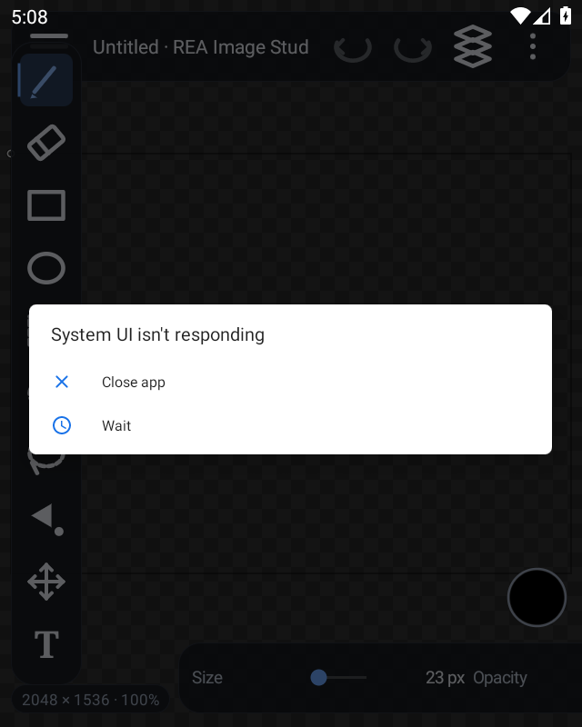
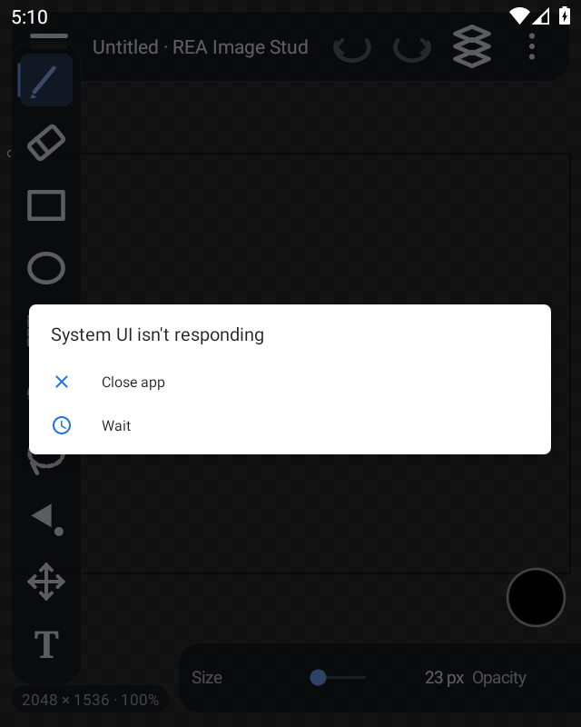
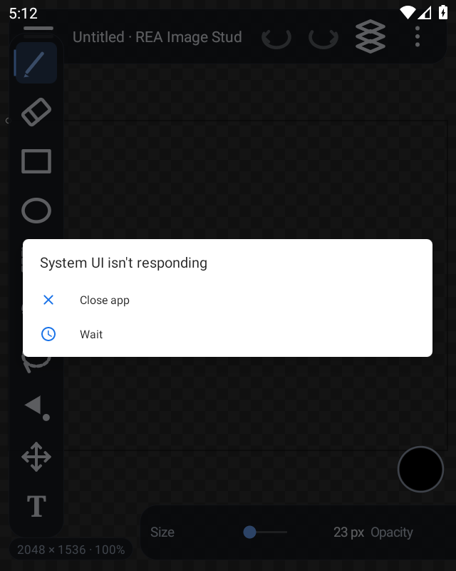

<!-- Written by .github/workflows/studio-smoke.yml. Do not edit by hand. -->
# Studio app: emulator smoke test

Run [40916762659](https://github.com/Rishidev-20thcenturey/rea-image-studio./actions/runs/40916762659), commit `505e319be59ee9ddb3cb6c87ef1e61abc1a4c594`, 2026-10-29T17:17:30Z.
x86_64 build of the same code the arm64 APK ships.

```
== device ==
List of devices attached
emulator-5554	device

booted after 1 checks
sdk: 29
abi: x86_64
size: 640x800
page size: 4096
apk: 3139126 bytes

== install ==
Performing Streamed Install
Success
package:/data/app/com.rea.studio--CpC0O7htZrjnItmla3nqA==/base.apk
installed

== launch ==
Starting: Intent { cmp=com.rea.studio/.MainActivity }
Status: timeout
LaunchState: UNKNOWN (-1)
Activity: com.rea.studio/.MainActivity
WaitTime: 13630
Complete

== first frame ==
screenshot 01-launch: 47882 bytes

== draw three strokes ==
screenshot 02-painted: 47451 bytes

== switch to the eraser from the rail, then undo ==
screenshot 03-tool: 47170 bytes

== open the layer panel ==
screenshot 04-layers: 47465 bytes

== open the menu ==
screenshot 05-menu: 47525 bytes

== the app's own boot log ==
REA Image Studio 0.1.0
onCreate
native library loaded: REA Image Studio core 0.1.0 (original implementation)
immersive mode set
building the canvas
interface laid out
document created
cat: files/diag/crash.txt: No such file or directory

== process ==
u0_a146       3700  1690 4943108 140092 0                   0 S com.rea.studio
the app process is running

== activity state ==
    * TaskRecord{b026fa2 #6 A=com.rea.studio U=0 StackId=1 sz=1}
      affinity=com.rea.studio
      intent={flg=0x10000000 cmp=com.rea.studio/.MainActivity}
      mActivityComponent=com.rea.studio/.MainActivity
      Activities=[ActivityRecord{79e7898 u0 com.rea.studio/.MainActivity t6}]
      mRootProcess=ProcessRecord{7591433 3700:com.rea.studio/u0a146}
      * Hist #0: ActivityRecord{79e7898 u0 com.rea.studio/.MainActivity t6}
          packageName=com.rea.studio processName=com.rea.studio
          app=ProcessRecord{7591433 3700:com.rea.studio/u0a146}
          Intent { flg=0x10000000 cmp=com.rea.studio/.MainActivity }

== crash, ANR and JNI errors in logcat ==
10-29 17:08:02.332  1949  1978 E ActivityManager: ANR in com.google.android.googlequicksearchbox:search
10-29 17:08:09.149  1949  2235 I ActivityTaskManager: START u0 {flg=0x10000000 cmp=com.rea.studio/.MainActivity} from uid 2000
10-29 17:08:11.360  3700  3700 I com.rea.studio: Late-enabling -Xcheck:jni
10-29 17:08:11.646  1949  1979 I ActivityManager: Start proc 3700:com.rea.studio/u0a146 for activity {com.rea.studio/com.rea.studio.MainActivity}
10-29 17:08:12.066  3700  3700 E com.rea.studio: Unknown bits set in runtime_flags: 0x8000
10-29 17:08:12.070  3700  3700 W com.rea.studio: Unexpected CPU variant for X86 using defaults: x86_64
10-29 17:08:20.300  3700  3700 W RenderThread: type=1400 audit(0.0:26): avc: denied { write } for name="property_service" dev="tmpfs" ino=7852 scontext=u:r:untrusted_app:s0:c146,c256,c512,c768 tcontext=u:object_r:property_socket:s0 tclass=sock_file permissive=0 app=com.rea.studio
10-29 17:08:18.184  3700  3700 I com.rea.studio: Waiting for a blocking GC ClassLinker
10-29 17:08:18.846  3700  3700 I com.rea.studio: WaitForGcToComplete blocked ClassLinker on HeapTrim for 662.502ms
10-29 17:08:20.002  1949  1978 E ActivityManager: ANR in com.google.android.gms
10-29 17:08:20.002  1949  1978 E ActivityManager:  +0% 3700/com.rea.studio: 0% user + 0% kernel
10-29 17:08:20.138  3700  3700 W com.rea.studio: Verification of void com.rea.studio.MainActivity.$r8$lambda$5FwmezL8OlWRHDim9hjJvf1JDf8(com.rea.studio.MainActivity, com.rea.studio.SliderRow, com.rea.studio.SliderRow, com.rea.studio.SliderRow, android.content.DialogInterface, int) took 106.900ms
10-29 17:08:25.519  3700  3715 I com.rea.studio: Background concurrent copying GC freed 1607(105KB) AllocSpace objects, 0(0B) LOS objects, 49% free, 3328KB/6657KB, paused 60us total 1.733s
10-29 17:08:28.151  1949  1978 E ActivityManager: ANR in com.google.android.ims
10-29 17:08:28.151  1949  1978 E ActivityManager:   39% 3700/com.rea.studio: 6.6% user + 32% kernel / faults: 6468 minor 7 major
10-29 17:08:34.029  1949  1978 E ActivityManager: ANR in com.google.android.gms.persistent
10-29 17:08:39.034  1949  1978 E ActivityManager: ANR in com.google.android.googlequicksearchbox:search
10-29 17:09:03.371  1949  1978 E ActivityManager: ANR in android.process.media
10-29 17:09:17.781  4134  4134 D AndroidRuntime: >>>>>> START com.android.internal.os.RuntimeInit uid 2000 <<<<<<
10-29 17:09:17.926  4134  4134 I AndroidRuntime: Using default boot image
10-29 17:09:17.933  4134  4134 I AndroidRuntime: Leaving lock profiling enabled
10-29 17:09:27.472  1949  1978 E ActivityManager: ANR in com.google.android.gms.persistent
10-29 17:09:34.668  4134  4134 D AndroidRuntime: Calling main entry com.android.commands.input.Input
10-29 17:09:35.851  4134  4134 D AndroidRuntime: Shutting down VM
10-29 17:09:38.692  1949  1978 E ActivityManager: ANR in android.process.media
10-29 17:09:50.485  1949  1978 E ActivityManager: ANR in com.google.android.googlequicksearchbox:search
10-29 17:09:50.485  1949  1978 E ActivityManager:   0% 3700/com.rea.studio: 0% user + 0% kernel
10-29 17:09:55.761  4369  4369 D AndroidRuntime: >>>>>> START com.android.internal.os.RuntimeInit uid 2000 <<<<<<
10-29 17:09:56.157  4369  4369 I AndroidRuntime: Using default boot image
10-29 17:09:56.176  4369  4369 I AndroidRuntime: Leaving lock profiling enabled
10-29 17:09:57.813  1949  1978 E ActivityManager: ANR in com.google.android.apps.docs
10-29 17:10:04.973  4369  4369 D AndroidRuntime: Calling main entry com.android.commands.input.Input
10-29 17:10:06.417  4369  4369 D AndroidRuntime: Shutting down VM
10-29 17:10:11.893  1949  1977 I ActivityTaskManager: Displayed com.rea.studio/.MainActivity: +18s271ms
10-29 17:10:20.367  4536  4536 D AndroidRuntime: >>>>>> START com.android.internal.os.RuntimeInit uid 2000 <<<<<<
10-29 17:10:20.618  4536  4536 I AndroidRuntime: Using default boot image
10-29 17:10:20.619  4536  4536 I AndroidRuntime: Leaving lock profiling enabled
10-29 17:10:21.873  1949  1978 E ActivityManager: ANR in com.google.android.gms.persistent
10-29 17:10:24.951  1949  1978 E ActivityManager: ANR in android.process.media
10-29 17:10:28.721  4536  4536 D AndroidRuntime: Calling main entry com.android.commands.input.Input
10-29 17:10:31.260  4536  4536 D AndroidRuntime: Shutting down VM
10-29 17:11:05.557  1949  1978 E ActivityManager: ANR in com.google.android.apps.docs
10-29 17:11:09.902  1949  1978 E ActivityManager: ANR in android.process.media
10-29 17:11:10.068  4768  4768 D AndroidRuntime: >>>>>> START com.android.internal.os.RuntimeInit uid 2000 <<<<<<
10-29 17:11:10.598  4768  4768 I AndroidRuntime: Using default boot image
10-29 17:11:10.676  4768  4768 I AndroidRuntime: Leaving lock profiling enabled
10-29 17:11:21.193  4768  4768 D AndroidRuntime: Calling main entry com.android.commands.input.Input
10-29 17:11:21.698  4768  4768 D AndroidRuntime: Shutting down VM
10-29 17:11:31.692  1949  1978 E ActivityManager: ANR in com.google.android.gms.persistent
10-29 17:11:43.791  1949  1978 E ActivityManager: ANR in com.google.android.apps.docs
10-29 17:11:59.470  5011  5011 D AndroidRuntime: >>>>>> START com.android.internal.os.RuntimeInit uid 2000 <<<<<<
10-29 17:11:59.677  5011  5011 I AndroidRuntime: Using default boot image
10-29 17:11:59.677  5011  5011 I AndroidRuntime: Leaving lock profiling enabled
10-29 17:12:07.026  1949  2418 W BroadcastQueue: Background execution not allowed: receiving Intent { act=android.intent.action.PACKAGE_ADDED dat=package:com.rea.studio flg=0x4000010 (has extras) } to com.google.android.packageinstaller/com.android.packageinstaller.PackageInstalledReceiver
10-29 17:12:07.046  1949  1978 W BroadcastQueue: Background execution not allowed: receiving Intent { act=android.intent.action.PACKAGE_ADDED dat=package:com.rea.studio flg=0x4000010 (has extras) } to com.android.musicfx/.Compatibility$Receiver
10-29 17:12:07.047  1949  1978 W BroadcastQueue: Background execution not allowed: receiving Intent { act=android.intent.action.PACKAGE_ADDED dat=package:com.rea.studio flg=0x4000010 (has extras) } to com.google.android.apps.enterprise.dmagent/.AppUpdateReceiver
10-29 17:12:07.047  1949  1978 W BroadcastQueue: Background execution not allowed: receiving Intent { act=android.intent.action.PACKAGE_ADDED dat=package:com.rea.studio flg=0x4000010 (has extras) } to com.google.android.googlequicksearchbox/com.google.android.apps.gsa.googlequicksearchbox.GelStubAppWatcher
10-29 17:12:07.047  1949  1978 W BroadcastQueue: Background execution not allowed: receiving Intent { act=android.intent.action.PACKAGE_ADDED dat=package:com.rea.studio flg=0x4000010 (has extras) } to com.google.android.ims/.receivers.RcsAutoStartReceiver
10-29 17:12:13.821  5011  5011 D AndroidRuntime: Calling main entry com.android.commands.input.Input
10-29 17:12:14.763  5011  5011 D AndroidRuntime: Shutting down VM
10-29 17:12:28.753  1949  1978 E ActivityManager: ANR in com.google.android.apps.docs
10-29 17:12:29.289  5188  5188 D AndroidRuntime: >>>>>> START com.android.internal.os.RuntimeInit uid 2000 <<<<<<
10-29 17:12:29.591  5188  5188 I AndroidRuntime: Using default boot image
10-29 17:12:29.631  5188  5188 I AndroidRuntime: Leaving lock profiling enabled
10-29 17:12:38.821  5188  5188 D AndroidRuntime: Calling main entry com.android.commands.input.Input
10-29 17:12:39.332  5188  5188 D AndroidRuntime: Shutting down VM
10-29 17:12:45.412  1949  1978 E ActivityManager: ANR in com.google.android.gms.persistent
10-29 17:12:49.253  1949  1978 W BroadcastQueue: Background execution not allowed: receiving Intent { act=android.intent.action.PACKAGE_ADDED dat=package:com.rea.studio flg=0x4000010 (has extras) } to com.google.android.gms/.games.chimera.GamesSystemBroadcastReceiverProxy
10-29 17:12:49.569  1949  1978 W BroadcastQueue: Background execution not allowed: receiving Intent { act=android.intent.action.PACKAGE_ADDED dat=package:com.rea.studio flg=0x4000010 (has extras) } to com.google.android.gms/.gass.chimera.PackageChangeBroadcastReceiver
10-29 17:12:49.571  1949  1978 W BroadcastQueue: Background execution not allowed: receiving Intent { act=android.intent.action.PACKAGE_ADDED dat=package:com.rea.studio flg=0x4000010 (has extras) } to com.google.android.gms/.chimera.GmsIntentOperationService$PersistentTrustedReceiver
10-29 17:13:09.883  1949  1978 E ActivityManager: ANR in com.google.android.apps.docs
10-29 17:13:15.359  5405  5405 D AndroidRuntime: >>>>>> START com.android.internal.os.RuntimeInit uid 2000 <<<<<<
10-29 17:13:15.434  5405  5405 I AndroidRuntime: Using default boot image
10-29 17:13:15.439  5405  5405 I AndroidRuntime: Leaving lock profiling enabled
10-29 17:13:21.054  5405  5405 D AndroidRuntime: Calling main entry com.android.commands.input.Input
10-29 17:13:21.476  5405  5405 D AndroidRuntime: Shutting down VM
10-29 17:13:29.978  1949  1978 E ActivityManager: ANR in com.google.android.ims
10-29 17:13:37.134  5500  5500 D AndroidRuntime: >>>>>> START com.android.internal.os.RuntimeInit uid 2000 <<<<<<
10-29 17:13:37.881  5500  5500 I AndroidRuntime: Using default boot image
10-29 17:13:37.882  5500  5500 I AndroidRuntime: Leaving lock profiling enabled

== result ==
ok 1793293702798
RESULT: the app reached a drawn interface
evidence: /home/runner/work/_temp/smoke.txt
```

## Device log (filtered)

```
10-29 17:15:22.777  5756  5826 W RcsProvisioning: 	at libcore.io.ForwardingOs.open(ForwardingOs.java:167)
10-29 17:15:22.777  5756  5826 W RcsProvisioning: 	at libcore.io.IoBridge.open(IoBridge.java:482)
10-29 17:15:24.300  5756  5826 W RcsProvisioning: 	at libcore.io.IoBridge.open(IoBridge.java:496)
10-29 17:15:24.300  5756  5826 W RcsProvisioning: 	at libcore.io.Linux.open(Native Method)
10-29 17:15:24.300  5756  5826 W RcsProvisioning: 	at libcore.io.ForwardingOs.open(ForwardingOs.java:167)
10-29 17:15:24.300  5756  5826 W RcsProvisioning: 	at libcore.io.BlockGuardOs.open(BlockGuardOs.java:252)
10-29 17:15:24.300  5756  5826 W RcsProvisioning: 	at libcore.io.ForwardingOs.open(ForwardingOs.java:167)
10-29 17:15:24.300  5756  5826 W RcsProvisioning: 	at libcore.io.IoBridge.open(IoBridge.java:482)
10-29 17:15:27.506  5756  5826 I BugleRcsEngine: [82] omj.shouldUseCarrierServicesApkForV1Apis: Checking if using CarrierServices.apk is possible. Enabled: true, isAtLeastM: true, runningInsideBugle: true
10-29 17:15:27.831  5725  5754 W libc    : Unable to set property "qemu.gles" to "1": connection failed; errno=13 (Permission denied)
10-29 17:15:29.314  1949  1977 W android.os.Debug: failed to get memory consumption info: -1
10-29 17:15:31.200  5756  5826 W RcsProvisioning: 	at libcore.io.IoBridge.open(IoBridge.java:496)
10-29 17:15:31.200  5756  5826 W RcsProvisioning: 	at libcore.io.Linux.open(Native Method)
10-29 17:15:31.200  5756  5826 W RcsProvisioning: 	at libcore.io.ForwardingOs.open(ForwardingOs.java:167)
10-29 17:15:31.200  5756  5826 W RcsProvisioning: 	at libcore.io.BlockGuardOs.open(BlockGuardOs.java:252)
10-29 17:15:31.200  5756  5826 W RcsProvisioning: 	at libcore.io.ForwardingOs.open(ForwardingOs.java:167)
10-29 17:15:31.200  5756  5826 W RcsProvisioning: 	at libcore.io.IoBridge.open(IoBridge.java:482)
10-29 17:15:32.011  1949  1977 W android.os.Debug: failed to get memory consumption info: -1
10-29 17:15:32.467  5756  5826 W RcsProvisioning: 	at libcore.io.IoBridge.open(IoBridge.java:496)
10-29 17:15:32.467  5756  5826 W RcsProvisioning: 	at libcore.io.Linux.open(Native Method)
10-29 17:15:32.467  5756  5826 W RcsProvisioning: 	at libcore.io.ForwardingOs.open(ForwardingOs.java:167)
10-29 17:15:32.467  5756  5826 W RcsProvisioning: 	at libcore.io.BlockGuardOs.open(BlockGuardOs.java:252)
10-29 17:15:32.467  5756  5826 W RcsProvisioning: 	at libcore.io.ForwardingOs.open(ForwardingOs.java:167)
10-29 17:15:32.467  5756  5826 W RcsProvisioning: 	at libcore.io.IoBridge.open(IoBridge.java:482)
10-29 17:15:32.966  1949  1978 I system_server: libdebuggerd_client: started dumping process 5712
10-29 17:15:33.046  1786  1786 I /system/bin/tombstoned: registered intercept for pid 5712 and type kDebuggerdJavaBacktrace
10-29 17:15:33.448  1949  1977 W android.os.Debug: failed to get memory consumption info: -1
10-29 17:15:34.496  1949  1977 W android.os.Debug: failed to get memory consumption info: -1
10-29 17:15:35.437  5543  5543 W RcsProvisioning: 	at libcore.io.IoBridge.open(IoBridge.java:496)
10-29 17:15:35.437  5543  5543 W RcsProvisioning: 	at libcore.io.Linux.open(Native Method)
10-29 17:15:35.437  5543  5543 W RcsProvisioning: 	at libcore.io.ForwardingOs.open(ForwardingOs.java:167)
10-29 17:15:35.437  5543  5543 W RcsProvisioning: 	at libcore.io.BlockGuardOs.open(BlockGuardOs.java:252)
10-29 17:15:35.437  5543  5543 W RcsProvisioning: 	at libcore.io.ForwardingOs.open(ForwardingOs.java:167)
10-29 17:15:35.437  5543  5543 W RcsProvisioning: 	at libcore.io.IoBridge.open(IoBridge.java:482)
10-29 17:15:35.543  1949  1977 W android.os.Debug: failed to get memory consumption info: -1
10-29 17:15:37.024  1949  1977 W android.os.Debug: failed to get memory consumption info: -1
10-29 17:15:37.677  1949  1977 W android.os.Debug: failed to get memory consumption info: -1
10-29 17:15:38.625  1786  1786 I /system/bin/tombstoned: found intercept fd 512 for pid 5712 and type kDebuggerdJavaBacktrace
10-29 17:15:38.632  1949  1978 I system_server: libdebuggerd_client: done dumping process 5712
10-29 17:15:39.418  1949  1977 W android.os.Debug: failed to get memory consumption info: -1
10-29 17:15:41.336  1949  1977 W android.os.Debug: failed to get memory consumption info: -1
10-29 17:15:42.756  5756  5772 I BugleRcsEngine: [76] omj.shouldUseCarrierServicesApkForV1Apis: Checking if using CarrierServices.apk is possible. Enabled: true, isAtLeastM: true, runningInsideBugle: true
10-29 17:15:43.357  1949  1977 W android.os.Debug: failed to get memory consumption info: -1
10-29 17:15:45.879  5756  5772 W RcsProvisioning: 	at libcore.io.IoBridge.open(IoBridge.java:496)
10-29 17:15:45.879  5756  5772 W RcsProvisioning: 	at libcore.io.Linux.open(Native Method)
10-29 17:15:45.879  5756  5772 W RcsProvisioning: 	at libcore.io.ForwardingOs.open(ForwardingOs.java:167)
10-29 17:15:45.879  5756  5772 W RcsProvisioning: 	at libcore.io.BlockGuardOs.open(BlockGuardOs.java:252)
10-29 17:15:45.879  5756  5772 W RcsProvisioning: 	at libcore.io.ForwardingOs.open(ForwardingOs.java:167)
10-29 17:15:45.879  5756  5772 W RcsProvisioning: 	at libcore.io.IoBridge.open(IoBridge.java:482)
10-29 17:15:45.909  1949  1977 W android.os.Debug: failed to get memory consumption info: -1
10-29 17:15:46.961  5756  5772 W RcsProvisioning: 	at libcore.io.IoBridge.open(IoBridge.java:496)
10-29 17:15:46.961  5756  5772 W RcsProvisioning: 	at libcore.io.Linux.open(Native Method)
10-29 17:15:46.961  5756  5772 W RcsProvisioning: 	at libcore.io.ForwardingOs.open(ForwardingOs.java:167)
10-29 17:15:46.961  5756  5772 W RcsProvisioning: 	at libcore.io.BlockGuardOs.open(BlockGuardOs.java:252)
10-29 17:15:46.961  5756  5772 W RcsProvisioning: 	at libcore.io.ForwardingOs.open(ForwardingOs.java:167)
10-29 17:15:46.961  5756  5772 W RcsProvisioning: 	at libcore.io.IoBridge.open(IoBridge.java:482)
10-29 17:15:46.977  1949  1977 W android.os.Debug: failed to get memory consumption info: -1
10-29 17:15:47.280  1949  1977 W android.os.Debug: failed to get memory consumption info: -1
10-29 17:15:48.322  1949  1977 W android.os.Debug: failed to get memory consumption info: -1
10-29 17:15:49.546  1949  1977 W android.os.Debug: failed to get memory consumption info: -1
10-29 17:15:49.944  6026  6026 D NetworkSecurityConfig: Using Network Security Config from resource network_security_config debugBuild: false
10-29 17:15:50.015  1949  1977 W android.os.Debug: failed to get memory consumption info: -1
10-29 17:15:50.597  1949  1977 W android.os.Debug: failed to get memory consumption info: -1
10-29 17:15:52.810  1949  1977 W android.os.Debug: failed to get memory consumption info: -1
10-29 17:15:53.663  3883  3883 W gle.android.gm: Long monitor contention with owner queued-work-looper (4062) at int libcore.io.Linux.write(java.io.FileDescriptor, byte[], int, int)(Linux.java:294) waiters=0 in void android.app.QueuedWork.processPendingWork() for 126ms
10-29 17:15:54.186  1949  1977 W android.os.Debug: failed to get memory consumption info: -1
10-29 17:16:22.158  1949  1978 I system_server: libdebuggerd_client: started dumping process 6026
10-29 17:16:22.176  1786  1786 I /system/bin/tombstoned: registered intercept for pid 6026 and type kDebuggerdJavaBacktrace
10-29 17:16:27.194  1786  1786 I /system/bin/tombstoned: found intercept fd 512 for pid 6026 and type kDebuggerdJavaBacktrace
10-29 17:16:27.388  1949  1978 I system_server: libdebuggerd_client: done dumping process 6026
10-29 17:16:41.346  6086  6126 W putmethod.lati: Long monitor contention with owner ExUtils-F-P9-1 (6146) at boolean libcore.io.Linux.access(java.lang.String, int)(Linux.java:-2) waiters=0 in android.content.res.Resources$Theme android.app.ContextImpl.getTheme() for 208ms
10-29 17:16:42.073  6157  6157 D NetworkSecurityConfig: Using Network Security Config from resource network_security_config debugBuild: false
10-29 17:16:48.602  5756  5845 I FA      : To enable debug logging run: adb shell setprop log.tag.FA VERBOSE
10-29 17:16:48.603  5756  5845 I FA      : To enable faster debug mode event logging run:
10-29 17:16:48.603  5756  5845 I FA      :   adb shell setprop debug.firebase.analytics.app com.google.android.apps.messaging
10-29 17:17:12.670  1949  1978 I system_server: libdebuggerd_client: started dumping process 6157
10-29 17:17:12.674  1786  1786 I /system/bin/tombstoned: registered intercept for pid 6157 and type kDebuggerdJavaBacktrace
10-29 17:17:17.056  1786  1786 I /system/bin/tombstoned: found intercept fd 512 for pid 6157 and type kDebuggerdJavaBacktrace
10-29 17:17:17.154  1949  1978 I system_server: libdebuggerd_client: done dumping process 6157
10-29 17:17:26.632  6261  6261 D NetworkSecurityConfig: Using Network Security Config from resource network_security_config debugBuild: false
```






